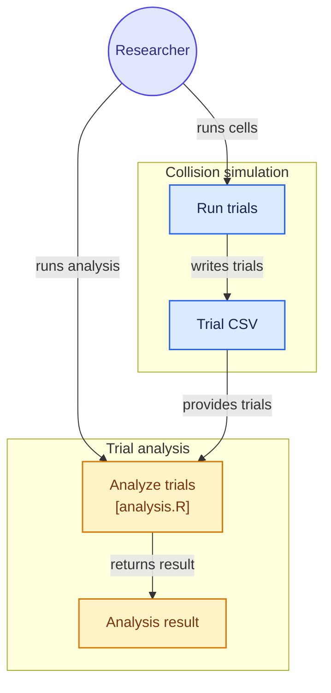

# How many hashes until two collide? 
A study of first-collision waiting times


## Run the study

1. From the repository root, run `uv sync --locked` to install the Python dependencies.
2. Open `how-many-hashes.ipynb` in an editor with Jupyter support, select the project's `.venv` Python interpreter, and run all cells with the repository root as the working directory. The notebook creates `results/` and writes trial CSVs there.
3. From the repository root, open an R console and run these commands.

```r
source("analysis.R")
result <- analyze_trials(file.path("results/trials_b16_n900_seed37430101.csv"))
```

The filename records the bit width, trial count, and seed. If you change those settings, use the path printed by the notebook. Git ignores generated trial CSVs.

Relative paths use the working directory. Check `Path.cwd()` in the notebook or `getwd()` in R if you cannot find the results. To run R from another directory, pass absolute paths to both `source()` and `analyze_trials()`.

[](https://gitdiagram.com/milanfusco/how-many-hashes?utm_source=readme&utm_medium=badge)

